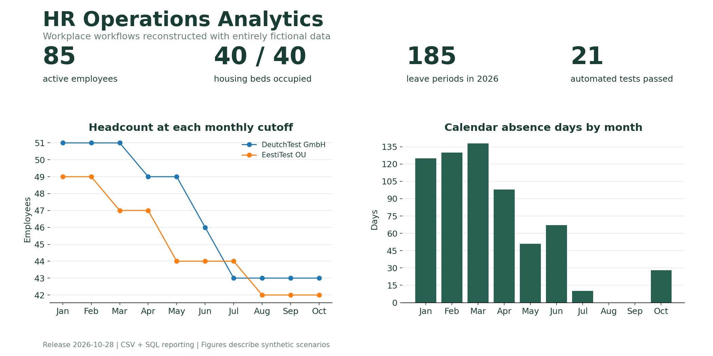

# HR Operations Analytics

**From company HR workflows to reproducible data analysis.**

I am Yakiv Petrov, an HR professional moving into data analytics. This portfolio is based on spreadsheets I designed and used in company operations to answer recurring questions about employees, accommodation, leave and absence.

I defined the business requirements, organized the records and chose the calculation rules. This public reconstruction uses **entirely fictional data**. The original company files are not included.



## Review in five minutes

1. **[Employee management](projects/employee-management/README.md):** reconstruct headcount on a selected date.
2. **[Housing history](projects/housing/README.md):** preserve moves and calculate occupancy without counting a move day twice.
3. **[SQL analysis](projects/sql-analysis/README.md):** run five parameterized reports and inspect their [saved outputs](examples/sql-results/).
4. **[Verification](docs/VALIDATION.md):** review reconciliations, boundary tests and release limits.

All case studies, images, CSVs and SQL are available inside this repository. A Google account is not needed to review them.

## Projects

| Case | Operational question | Skills demonstrated |
|---|---|---|
| [Employee management](projects/employee-management/README.md) | Who worked for each company on a given date? | Structured records, identifiers, historical headcount, tenure |
| [Housing history](projects/housing/README.md) | Who occupied each apartment, and when did they move? | Event records, interval joins, occupancy, validation |
| [Leave management](projects/leave-management/README.md) | What has accrued, been used and been reserved? | Policy parameters, conditional aggregation, balances |
| [Sick leave](projects/sick-leave/README.md) | How many cases started, and how many days fell in each month? | Overlap checks, date allocation, reporting cutoffs |
| [Reference PDF](projects/employee-references/README.md) | How can a stored record become a consistent document? | Python, CSV input, validation, PDF generation |
| [SQL analysis](projects/sql-analysis/README.md) | Can spreadsheet results be reproduced independently? | SQLite, joins, CTEs, date spines, reconciliation |

## Practical impact

| Workplace workflow | Before | After |
|---|---:|---:|
| Typical HR information/report request | Approximately 20-30 minutes | Approximately 2-5 minutes |
| Individual leave-balance request | Approximately 30 minutes | Approximately 1-2 minutes |

These are my observations from daily work, not controlled measurements. The workflows overlap and the savings should not be added together. No numerical error-reduction claim is made.

## Run the analysis

Python 3.10+; the SQL runner uses only the standard library.

```bash
python scripts/run_analysis.py --report-date 2026-10-28
python -m unittest discover -s tests -v
python scripts/check_release.py
```

To include PDF input tests and generate a document:

```bash
python -m pip install -r projects/employee-references/requirements.txt
python projects/employee-references/generate_reference.py --employee-id EMP-0086
```

Reports are written to `outputs/`, excluded from Git. Committed examples use the fixed release date **2026-10-28**. There are 21 tests; three PDF input tests require ReportLab and are skipped if it is absent.

## What this release demonstrates

- A common EmployeeID connects employee, stay, leave and absence records.
- Explicit rules define employment end dates, exclusive housing checkout and inclusive absence periods.
- Invalid records are excluded from affected totals and remain visible for correction.
- SQL results are reconciled against spreadsheet snapshots and independent daily allocation.
- A GitHub Actions workflow runs the checks after upload when Actions is enabled.

## My contribution and implementation support

The operational problems, workplace spreadsheets, requirements and process decisions come from my HR work. The English portfolio reconstruction, implementation support, release fixes, documentation and checks were developed with AI assistance. The **SQL extension was added for the portfolio**; it is not presented as a system deployed at my employer.

## Data and release boundaries

The release contains 100 fictional employees, two fictional employers, 10 apartments, 100 stays, 185 leave periods and 165 sickness periods. The workbook demos use local snapshots instead of external imports. They are independent demonstrations, not a synchronized production HR platform.

The `.xlsx` files are native Google Sheets exports for inspection. Google-specific formulas and chart features may not recalculate identically in Excel. Use the CSV/SQL workflow for reproducibility outside Google Sheets.

Read the [data dictionary](docs/DATA_DICTIONARY.md), [calculation methods](docs/METHODS.md), [release report](docs/RELEASE_REPORT.md) and [publication guide](PUBLISHING.md).
