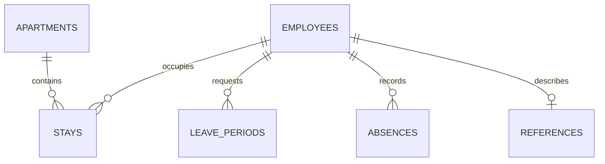

# Calculation methods

## Origin and release mode

The portfolio reconstructs spreadsheets designed and used by Yakiv Petrov in company HR operations. All published records are fictional. The original employer's files are not included. AI assistance supported reconstruction, implementation, documentation and verification. SQL is a new portfolio extension.

The release date is **2026-10-28**. Each Google Sheets demo uses its own saved employee snapshot and has no external import requirement. Cross-module updates are not automatic. This deliberate release mode makes the sample reproducible without granting access to a source spreadsheet.

## Data model

Each event has its own identifier. EmployeeID links events to people; ApartmentID links stays to accommodation. The spreadsheet interface retains name selection with uniqueness checks. SQL enforces primary and foreign keys.

## Rules

| Measure | Definition |
|---|---|
| Active headcount | Start <= reporting date; termination empty or >= reporting date |
| Former employees | Nonempty termination < reporting date |
| Monthly headcount | Month-end, capped at reporting date for the current month |
| Housing occupancy | Check-in <= reporting date < check-out; blank checkout is open-ended |
| Housing monthly days | Intersection of stay and calendar month; past/planned split at reporting date |
| Leave accrual | 13.36 hours per complete employment month through the earlier of reporting date or termination |
| Leave deduction | All supplied paid hours of valid periods whose start date has been reached |
| Future reservation | Paid hours of valid periods starting after reporting date |
| Leave days | Remaining hours / 8; calendar duration is not paid time |
| Sickness duration | End - start + 1 calendar days |
| Monthly sickness cases | Valid periods starting in the month by the reporting date |
| Monthly sickness days | Inclusive intersection of period, month and reporting cutoff |
| Expected return | Next Monday-Friday weekday after the end date; not confirmed attendance |

Leave policy is a demonstration assumption, not a universal entitlement rule. No expiry, carryover cap, holidays, shift calendars or payroll calculation is modeled. Accrual spans employment, while the sample leave log contains 2026 events; large balances reflect that synthetic history, not verified entitlements.

## Data quality

Leave and sickness checks cover identifiers, dates, employment boundaries and overlaps. Housing checks apartment/employee keys, dates and overlapping stays for the same employee; it does not independently establish employment eligibility or validate every rental-period constraint.

Only `OK` records feed leave deductions/reservations, housing occupancy/calendars and sickness totals. Both records in an overlapping pair are excluded until corrected. Workbook Read Me pages expose excluded-record counts; leave balances also warn per employee. A reduced total with exclusions must not be interpreted as complete.

SQL consumes the released validation statuses. Tests independently check the supplied release for overlaps, keys and selected date rules. They do not replace every spreadsheet validation rule for arbitrary new datasets.

## Scope

- One employment interval and one company per person; no rehire or transfer history.
- Spreadsheet company charts are configured for two employers. SQL groups employers dynamically.
- Most prepared ranges end at row 1001. Sick leave uses 100 directory entries and 500 absence rows.
- Housing calendars are specific to 2026. SQL reports accept a reporting date.
- Reference-document sickness values and assessments are separate fictional examples.
- Contact, insurance and medical fields are fictional and not used for employment-decision scoring.

## Formats and dates

Google Sheets is the native calculation engine. XLSX files are exports, not separately certified Excel applications; array, QUERY, SPARKLINE and chart behavior may differ. CSVs are UTF-8 with ISO dates. The Python runner loads selected fields into SQLite and executes parameterized SQL.

Employee status and tenure are fixed to the release date; the headcount selector supports historical months. Leave, housing and sickness date controls remain editable. Changing one workbook does not update the others or committed CSV/PNG files.
