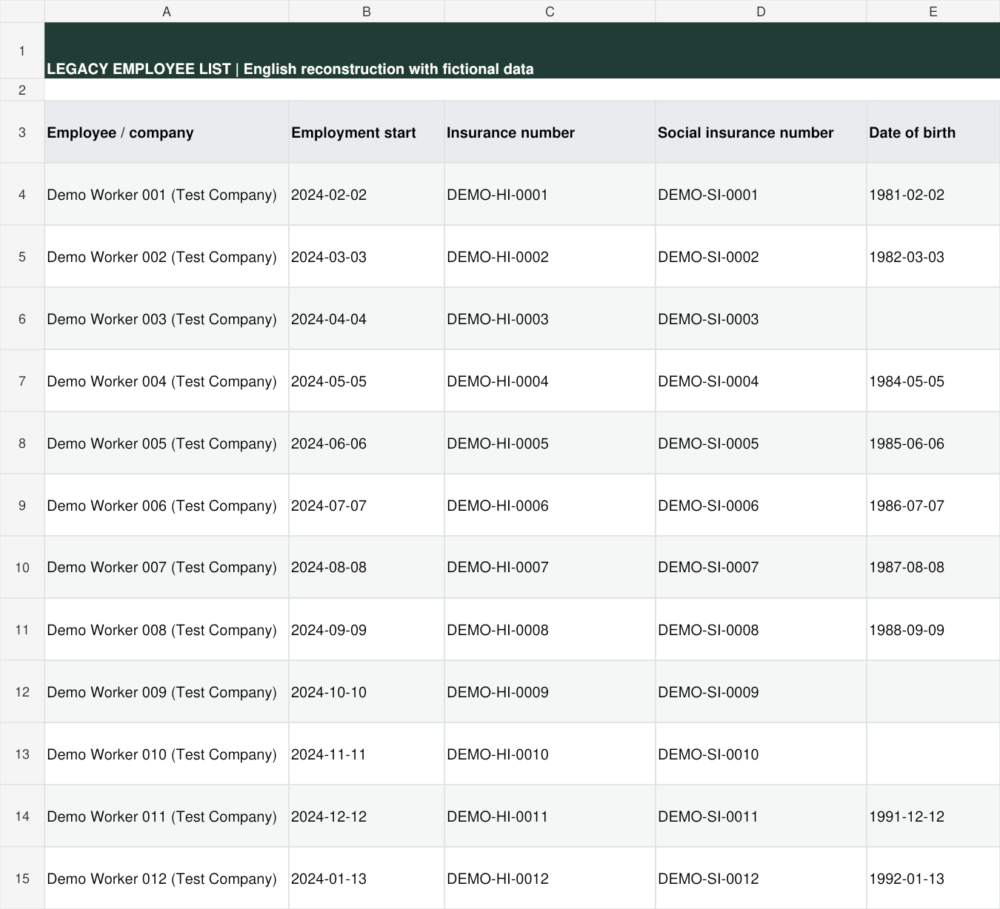
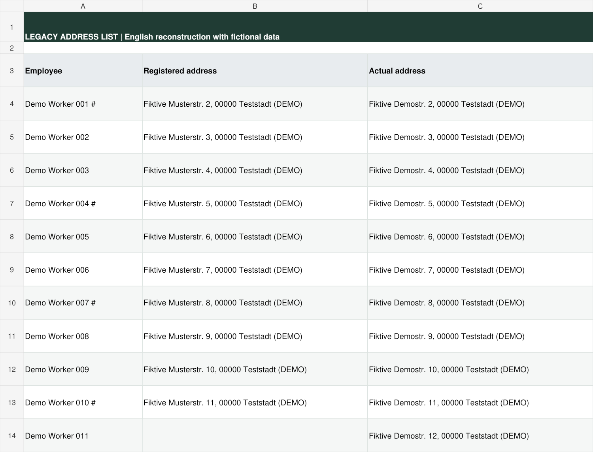
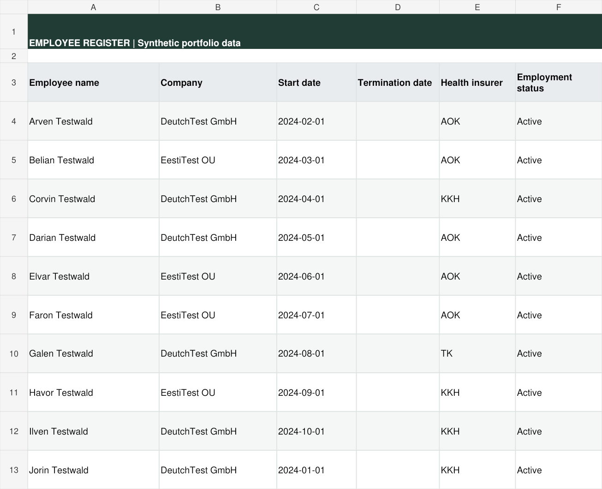
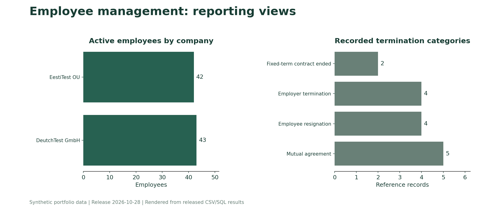

# Employee Management

**A structured employee register that supports recurring HR questions.**

## Business context

Management and colleagues ask how many employees work in each company, when they started, how long they have worked and what information is available about former employees. Accounting also requests information such as the distribution of health insurers.

These questions are part of my broader HR administration responsibilities. I chose to organize the underlying data so that a new request would not require repeating the same manual search and count.

## Previous approach

The supplied legacy employee list combined the employee and company in a text field. Addresses were maintained separately. In the supplied versions, the employee and address files did not contain formulas linking the records or a dedicated employee identifier.

These are translated illustrative excerpts, not original screenshots or a complete recreation of every formatting detail. No real employee records are shown.

## My solution

I separated names, companies, employment dates, statuses, insurers and addresses into consistent fields. EmployeeID provides the relationship key; names remain the main display field.

| Component | Purpose |
|---|---|
| Employees | Current and former employee records, dates, company, contacts, insurer and address fields |
| Address Register | A derived address view that excludes employees currently marked Terminated |
| BI Headcount | Current headcount and a selected-month historical view |
| BI Tenure | Length of service and tenure distributions |
| Employee References | Stored fictional assessments for former employees |
| BI Termination Reasons | Counts and shares of recorded termination categories |

## Result

In my day-to-day work, typical HR information requests that previously took approximately 20-30 minutes can now be prepared in approximately 2-5 minutes. This is a personal working estimate, not a formal timing study.

The main change is a reusable source of structured information instead of a separate preparation exercise for every question.

## How to inspect

- [Optional native demo and access notes](../../docs/ONLINE_DEMOS.md)
- [Released workbook export](../../workbooks/employee-management.xlsx)
- [Employee records](../../data/employees.csv), [addresses](../../data/addresses.csv), [reference records](../../data/employee_references.csv)
- [Python reference-document example](../employee-references/README.md)

## Calculation boundaries

The termination date is treated as the last employed day. Historical headcount uses employment dates rather than the employee's current status alone. The current model assumes one employment period and one recorded company per employee; it does not reconstruct internal transfers or rehire histories.

Termination categories are recorded administrative categories, not proven explanations of why people leave. Health-insurer information is available for filtering; there is no dedicated insurer dashboard in this release. The address view can include employees whose start date is still in the future.

## Release behavior

Employee status and tenure are fixed to 2026-10-28. The historical headcount selector uses that date as its latest cutoff. Company charts are configured for two employers; expand summary and chart ranges before adding a third. The SQL extension groups companies dynamically.
