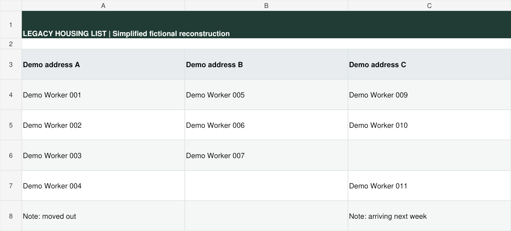
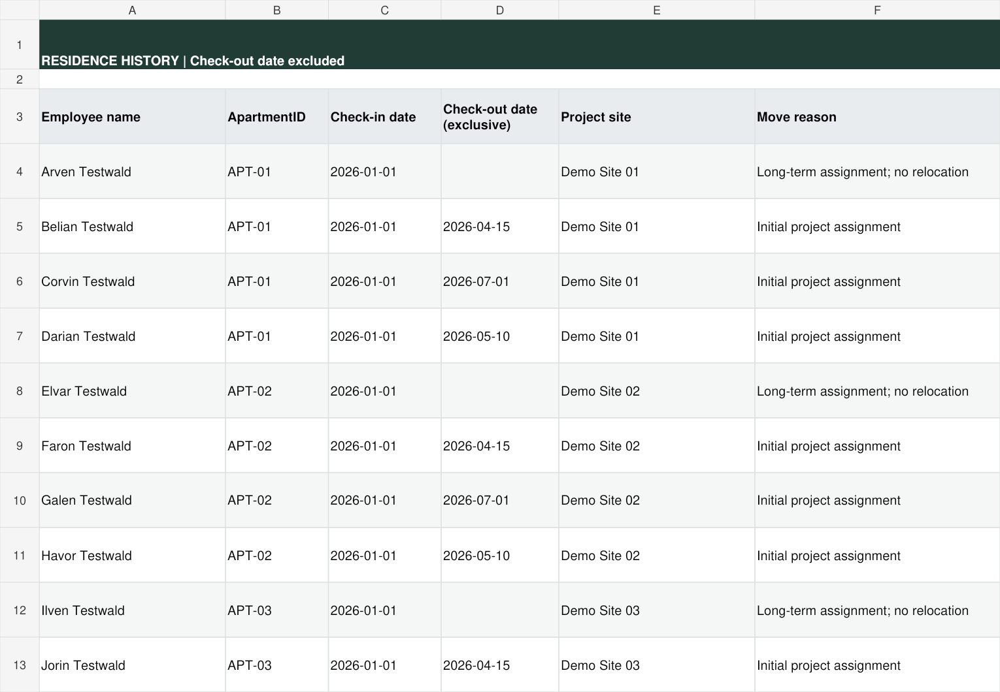
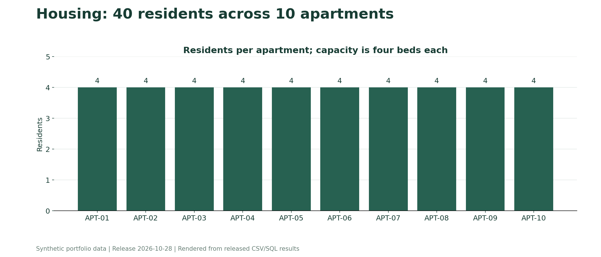

# Housing 2026

**Preserving accommodation history through dated stays and daily occupancy reports.**

## Business context

After a tax audit that lasted three years, the company asked for employee accommodation records. The required outcome was clear, but the method was not specified.

I designed the tracking approach myself. It needed to support both daily accommodation planning and requests from accounting for residence information by month.

## Previous approach

The legacy file grouped residents under apartment addresses. General worker lists, transport details and free-text notes appeared on the same sheet. A note could indicate that someone had moved out, but the current list did not provide a structured history of stay intervals.

This is a simplified English illustration of the address-block approach using fictional values. It is not an original screenshot or a record of actual occupancy.

## My solution

The basic record is a stay: one employee, one apartment, a check-in date and a check-out date. A move ends one stay and starts another, preserving the earlier record.

| Component | Function |
|---|---|
| Apartments | Apartment address, capacity, rental dates and residents on the reporting date |
| Stays | Dated stays, project sites and move notes |
| Residence | Company-housing residents and registration information on the selected date |
| January-December 2026 | Daily occupancy and monthly totals |

The demo contains 10 apartments and 40 residents, with both stable residence and moves between sites. Twenty residents are registered at company accommodation; twenty have another registration address.

## Date rule

Check-in is included; check-out is excluded. A move on April 1 counts March 31 as the last day in the previous apartment and April 1 as the first day in the new apartment. The same move day is therefore not counted twice.

## Practical result

The workplace table became a central source for accommodation planning and monthly residence reports. Updating a stay replaces repeated manual completion of daily cells. No separate housing-specific time-saving measurement is claimed.

## How to inspect

- [Optional native demo and access notes](../../docs/ONLINE_DEMOS.md)
- [Released workbook export](../../workbooks/housing.xlsx)
- [Apartments](../../data/apartments.csv), [stays](../../data/stays.csv), [residence snapshot](../../data/residence.csv)

The reporting date is controlled in `Apartments!H2`; it is not necessarily today's date. The `P` marker means planned occupancy. It is a display symbol, not a separate resident or event.

Counts depend on entered dates and do not independently verify physical presence. The file supports reporting; it is not a guarantee of tax compliance. The release uses a local employee and address snapshot. No external import permission is required. Invalid stays are excluded from occupancy, resident lists and all monthly calendars; the Read Me page shows the excluded-record count.

## Occupancy result

All 40 beds are occupied in this synthetic snapshot. The chart is rendered from the released SQL result, not a company screenshot. The SQL query also reports available beds and flags over-capacity results.
