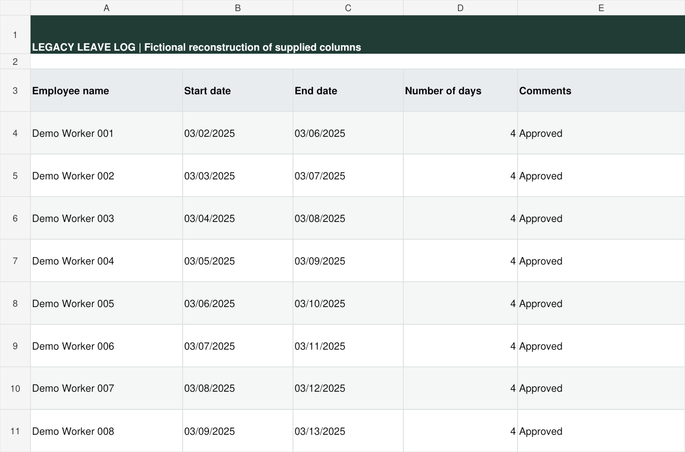
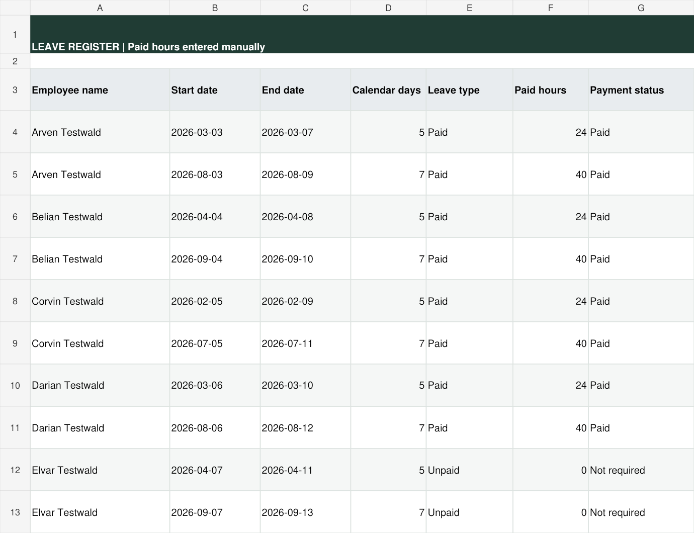
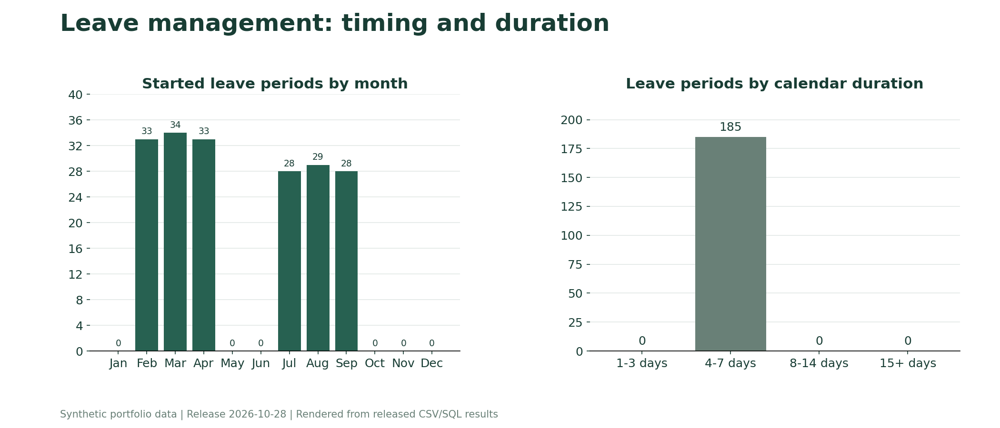

# Leave Management

**Answering leave-balance questions without creating a separate calculation each time.**

## Business context

Employees regularly ask how much leave they have available now or at a planned date. Requests also arise about unused balances for review by accounting.

Previously, preparing a reliable balance required a separate calculation and approximately 30 minutes of work. I chose to automate this recurring task so that the answer could be obtained from maintained records.

## Previous approach

The supplied leave log contained employee names, start and end dates, a day count and comments. Some periods already had duration formulas. The improvement was therefore not the first use of formulas: it was connecting the history to accumulated and remaining leave.

This English reconstruction illustrates the original columns. It does not reproduce personal records. Some legacy formulas used end minus start; the new register explicitly includes both dates in calendar duration.

## My solution

- **Leave:** employee, period, calendar duration, paid hours, payment status and approval notes.
- **Leave Balances:** accrued hours, deductions, remaining hours/days and future reservations.
- **BI Leave Patterns:** distribution by start month and duration group.

## Result

Based on my working experience, answering an individual balance request now takes approximately 1-2 minutes instead of approximately 30 minutes. A separate spreadsheet calculation is no longer required for each request.

This is an observed workflow improvement, not a formally controlled benchmark or a claim of zero errors.

## Calculation rules

The demonstration accrues **13.36 hours per complete month** and converts hours to days using **8 hours per day**. Accrual stops at the earlier of the reporting date and termination date. These are configured demonstration rules, not a universal statutory leave entitlement calculation.

Calendar duration includes both start and end dates. Paid hours are manually entered; calendar duration is not automatically treated as paid working time. Future reservations are shown separately. Users select the reporting date in `Leave Balances!O2`; the snapshot's reporting date is fixed until changed.

## How to inspect

- [Optional native demo and access notes](../../docs/ONLINE_DEMOS.md)
- [Released workbook export](../../workbooks/leave-management.xlsx)
- [Leave records](../../data/leave.csv) and [balances](../../data/leave_balances.csv)

The dashboard counts periods by their start month, not one person per month. Duration is expressed in calendar days. Employee lookups use a local snapshot. Deductions and future reservations include only valid records, and affected balances warn about excluded records. Decisions about payments remain outside this demonstration.

## Release behavior

All paid hours of a valid period are deducted when its start date is reached. Both overlapping records are excluded until resolved, and the balance warns about excluded records. The reporting date starts at 2026-10-28. The sample log contains 2026 leave only, while accrual spans employment; balances illustrate mechanics rather than complete historical entitlement.
