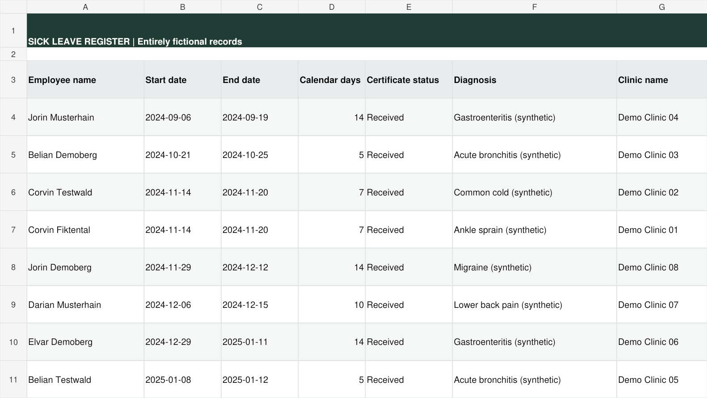
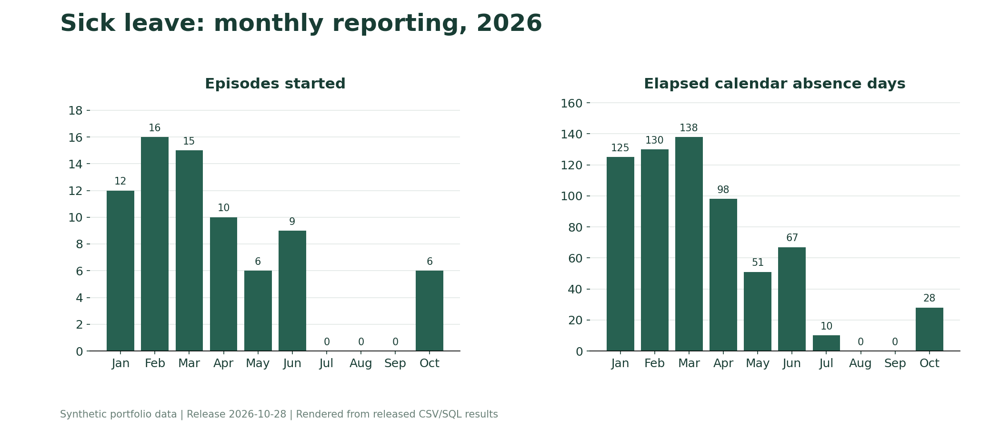

# Sick Leave Management

**A self-initiated absence register for operational visibility and monthly reporting.**

## Why I created it

This was my own initiative. There is no inherited "before" system presented for this project.

HR, logistics and site/project managers need reliable information about recorded employee absences and their expected duration. A maintained register helps coordinate staffing, transport and work allocation.

## Current demonstration

The workbook has two visible tabs:

1. **Sick Leave:** dates, duration, certificate status, expected return and record validation.
2. **BI Absence:** monthly counts of cases started and calendar absence days.

The release contains 165 synthetic periods for a 100-employee directory. Fictional diagnosis, clinic, clinic address and doctor fields demonstrate the supplied source structure. They are not real medical records and are not used to recommend employment decisions.

## Rules that prevent misleading totals

- One record represents one continuous period; an extension updates that period.
- Start and end dates are both included in calendar duration.
- Overlapping periods for the same employee are flagged and excluded from valid-record totals.
- Dates outside the recorded employment period are flagged.
- Monthly absence days are split across calendar boundaries; a case itself is counted once, in its start month.
- Monday-Friday days are separate from calendar days. Holidays and individual shifts are not modeled.
- The expected return is the next weekday after the end date, not a confirmation that the employee returned.

## How to inspect

- [Optional native demo and access notes](../../docs/ONLINE_DEMOS.md)
- [Released workbook export](../../workbooks/sick-leave.xlsx)
- [Synthetic sick-leave records](../../data/sick_leave.csv)

The reporting date is `BI Absence!B3`, fixed to 2026-10-28 for this release. Hidden sheets support local employee lookups; there is no external import requirement. Hidden tabs are not an access-control mechanism. Sharing the workbook would expose its contents to authorized viewers, so the public demo contains only synthetic information.

This module demonstrates record design, interval validation and operational reporting. It contains no individual misuse score or dismissal ranking. No quantified time saving is claimed for this workflow.
